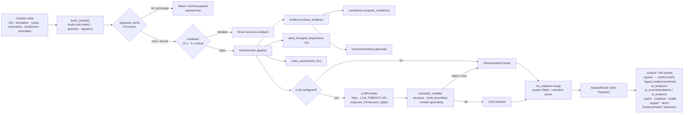

# TwinSphere AI — AI Analyst & Decision Support (Phase 8)

Evidence-grounded, provider-agnostic analyst that turns the live Phase 1–7
engines into an operator brief: what is happening, why, how confident it is,
what changed, and what to do next — with every claim linked to the evidence
that produced it.

## Guarantees

- **Evidence-grounded** — every recommendation and narrative claim resolves to
  a persisted evidence item (`anl_…:ev_N`) sourced from the engines; no
  free-floating assertions.
- **Provider-agnostic with a mandatory fallback** — an optional OpenAI-compatible
  LLM (`LLM_*` env) may rephrase the narrative; if it is unconfigured, slow
  (12 s timeout), malformed, or hallucinated, `fallback.py` answers from the
  same structured context. With no `LLM_API_KEY` the platform runs entirely on
  the deterministic analyst.
- **Strict schema** — the response is a validated `AnalystResult` (Pydantic):
  enums, length caps, probability ranges. Invalid enums are rejected at the
  API boundary (422) or the pipeline raises — never a half-parsed payload.
- **System-owned decisions** — the LLM never sets severity, priority or
  recommendations; those are computed deterministically and cannot be
  overridden by prose.
- **Advisory only** — recommendations are born `PENDING` with
  `requires_human_approval=true`; only a human (role `apply`) accepts or
  dismisses. The Analyst never executes an action and never blocks a
  simulation tick (LLM calls run fire-and-forget off the runtime loop).

## Architecture



### Module map (`ai/analyst/`)

| Module | Responsibility |
|---|---|
| `schemas.py` | `AnalystResult` + `Situation`/`EvidenceItem`/`ConfidenceBlock`/`RecommendationCard`/`RouteAssessment`/`ChangeItem`/`WhyFactor`/`PredictedEffect`; ladders (`max_severity`, `priority_for`) |
| `context.py` | `build_context(state, mode, building_id, question)` → normalized dict (campus/simulation/risk/anomalies/predictions/plan/evacuation blocks + `names`/`numbers` grounding sets + `freshness`); `context_signature()` md5; `detect_mode()`; MODES = CAMPUS · INCIDENT · BUILDING · ROUTE · SIMULATION · RECOVERY |
| `evidence.py` | `extract_evidence(ctx)` → grounded `EvidenceItem[]` (`ev_1…`); `grounding()` (known names/numbers), `ungrounded_numbers()` for LLM checks |
| `confidence.py` | `compute_confidence(ctx, evidence)` → 6 weighted components, 0.05–0.95 clamp, level + human-readable notes |
| `recommendations.py` | `generate(ctx, evidence, confidence)` → ranked cards (priority 1…9) with `evidence_ids` |
| `fallback.py` | deterministic narrative: severity/priority ladders, summaries, `why_for`, `affected_areas_for`, `predicted_effects_for`, `answer_question`, `_change_items`, legacy Phase 5 fields |
| `prompts.py` | `SYSTEM_PROMPT`, `build_user_prompt(ctx, baseline, question)`, `parse_llm_json` (fenced-JSON tolerant) |
| `providers.py` | `LLMConfig`, `Narrative`, `DeterministicProvider`, `LLMProvider` (httpx, temp 0.2, JSON object mode), `semantic_validate()` |
| `analyst.py` | `run_analysis(ctx, question, llm, previous)` orchestrator: evidence → confidence → recommendations → route assessment → what-changed → provider → strict result; `new_analysis_id()` (`anl_` + hex) |

Application glue lives in `backend/app/services/analyst_service.py`
(triggers/cache/cooldown/health/events/persistence — table below).

## Pipeline stages

1. **Context** — one normalized snapshot: mode (auto-detected or explicit),
   risk block, simulation block, active plan, evacuation, exits, anomalies,
   predictions, freshness, plus `names`/`numbers` sets used for grounding and a
   `signature` (md5) that identifies an unchanged situation.
2. **Evidence** — grounded facts from risk score/trend/factors, simulation
   scenario & people-at-risk, anomalies, predictions, route risk/exit status,
   bottlenecks, incidents, sensor health (`source_type` ∈ risk · simulation ·
   anomaly · prediction · route · evacuation · bottleneck · incident · sensor ·
   campus), each with `value`, `severity`, `timestamp`/`age_seconds`,
   `confidence` and `detail`.
3. **Confidence** — weighted blend (below) → `overall` (clamped 0.05–0.95),
   `level` (LOW/MEDIUM/HIGH ≥ 0.5/≥ 0.75), per-component breakdown and
   `notes` that explain every deduction in plain language.
4. **Recommendations** — deterministic ranking over evidence (monitoring,
   containment, evacuation posture, route choice, verification…) with
   `evidence_ids` linking back to facts.
5. **Assessments** — `route_assessment_for()` (status RECOMMENDED /
   ALTERNATIVE / NOT_RECOMMENDED / BLOCKED with route id, risk, ETA,
   alternatives) and `what_changed_for(previous context)` (RISK / ROUTE /
   SIMULATION / EVACUATION / PEOPLE change items with previous→current).
6. **Narrative** — LLM prose (if configured) or `fallback.py`, validated and
   merged; system-owned fields are never taken from the LLM.
7. **Result** — `AnalystResult` validated and returned to service layer.

## Confidence model

| Component | Weight | Signal |
|---|---|---|
| `sensor_availability` | 0.22 | healthy/total sensors (0.9 default when unknown); offline sensors add a note |
| `freshness` | 0.20 | mean of sensor/prediction/route age scores (≤15 s → 1.0 … >300 s → 0.15); stale streams add notes |
| `route_certainty` | 0.18 | active plan status RECOMMENDED 0.92 · ALTERNATIVE 0.75 · NOT_RECOMMENDED 0.55 · BLOCKED 0.4; incident without a plan → 0.5 |
| `prediction_confidence` | 0.15 | mean model confidence (0.7 default); low-confidence forecasts add a note |
| `anomaly_agreement` | 0.13 | active-anomaly penalty + agreement/disagreement with the campus risk level |
| `simulation_consistency` | 0.12 | risk trend vs simulation state (e.g. decreasing risk while a sim runs → note) |

`overall = Σ value × weight`, clamped to **[0.05, 0.95]** — the Analyst never
claims near-certainty. Levels: `≥ 0.75 HIGH · ≥ 0.50 MEDIUM · else LOW`.

## Severity & priority ladders

- **Severity** `LOW → MODERATE → ELEVATED → HIGH → CRITICAL`: risk band is the
  floor; an active incident raises to at least HIGH; `ACTIVE`/`CRITICAL`
  evacuation or risk ≥ 80 → CRITICAL (`fallback.severity_of`).
- **Priority** `LOW → MEDIUM → HIGH → IMMEDIATE` derived from severity
  (`schemas.priority_for`) — recommendations inherit it as a 1…9 ranking.
- **Health status** (separate concept): `ONLINE | FALLBACK | DEGRADED |
  OFFLINE` — see *Status & observability*.

## Human-in-the-loop decisions

`POST /api/ai/recommendations/{id}/decision` (role `apply`) accepts
`ACCEPTED` or `DISMISSED`. The DB row is the single source of truth:
`PENDING → ACCEPTED|DISMISSED` once; repeat → 409, unknown → 404, bad enum →
422. Decided rows record `decided_by`/`decided_at` and are reflected by every
subsequent `GET /api/ai/recommendations`. The FE hides the action buttons once
decided, so the UI cannot race the API.

## LLM integration contract

| Aspect | Behaviour |
|---|---|
| Config | `LLM_API_KEY` (empty → disabled), `LLM_MODEL` (default `gpt-4o-mini`), `LLM_BASE_URL` (default `https://api.openai.com/v1`), `LLM_TIMEOUT=12`, `LLM_MAX_TOKENS=900` |
| Request | `POST {base}/chat/completions`, `temperature 0.2`, `response_format: json_object`, system prompt + user prompt built from the structured context and the deterministic baseline |
| Validation | `semantic_validate()`: required structure (title ≤160, summary ≤1200, non-empty `what_is_happening`/`affected_areas`, valid `why`/`predicted_effects` objects) **plus grounding** — capitalized entity runs must match known names, numbers must appear in the context's number set |
| On failure (any) | timeout, HTTP error, non-JSON, structure/grounding rejection → deterministic baseline narrative with `source="local_fallback"`, `provider="deterministic"`, `note` explaining why; `status` becomes `local_fallback` |
| Never from LLM | severity, priority, recommendations, evidence, confidence — system-owned (§35) |

## Triggers, cache & cooldown

| Mechanism | Rule |
|---|---|
| API (`POST /api/ai/analyze`) | role `analyze`, always `force=True` (bypasses cache **and** cooldown) |
| Runtime trigger | every 30 ticks or on risk-level change → `analyst_service.schedule()` (fire-and-forget asyncio task, one in flight, cooldown/cache applied inside) |
| Signature cache | unchanged context signature reuses the last payload (`cached=true`, no re-persist); 20 entries (LRU-ish insert order) |
| Cooldown | `ANALYST_COOLDOWN_SECONDS=15` between triggered runs; CRITICAL severity or ACTIVE/CRITICAL evacuation → min(…, 5 s) |
| In-flight guard | `_analyst_inflight` — a second `schedule()` returns False while a run is executing |
| Failure handling | run exceptions increment `fail_streak` (≥3 → `OFFLINE`), logged and re-raised to the caller; persistence failures are logged but the analysis still returns |

## Status & observability

`GET /api/ai/status → {"analyst": …}` (also mirrored in the FE status pill):

- `status`: `OFFLINE` (3 consecutive run failures) → else `FALLBACK` (no LLM
  key) → else `DEGRADED` (≥2 consecutive LLM failures) → `ONLINE`.
- Bookkeeping: `runs`, `cache_hits`, `fallbacks`, `llm_errors`,
  `llm_fail_streak`, `fail_streak`, `last_run`, `last_latency_ms`,
  `last_source`, `last_error`, `cooldown_remaining_s`, `in_flight`,
  `cache_size`, `current_analysis`, `severity`, `persisted_limit`.

## Persistence (migration `p8d9f4b7a2c6e`)

| Table | Contents |
|---|---|
| `ai_analyses` | id (`anl_…`), mode, severity, priority, status, source, provider, model, title, summary, confidence(+level), question, context_signature, simulation_id, latency_ms, cached, full JSON payload (slimmed `context_summary`) — **bounded to 100 rows**, oldest pruned with their children |
| `ai_recommendations` | id, analysis_id, priority, category, action, reason, evidence[], evidence_ids[], confidence, requires_human_approval, status (`PENDING/ACCEPTED/DISMISSED/APPLIED`), decided_by/at |
| `ai_evidence` | id (**analysis-scoped**: `anl_…:ev_N`), analysis_id, label, source_type, source_id, metric, value, unit, severity, timestamp, age_seconds, confidence, detail |

Persistence failures never break an analysis (`log.exception`, response still
returns). Note: `SessionLocal` runs with `autoflush=False` — `_persist()`
explicitly flushes before the retention-window query.

## API surface

| Endpoint | Role | Notes |
|---|---|---|
| `POST /api/ai/analyze` | `analyze` | body `{question?, mode?}` (`focus` alias); 400 unknown mode; forces a run |
| `GET /api/ai/analyst` | `read` | latest in-memory result (runs one if empty) — Phase 5 compatibility |
| `GET /api/ai/analysis?limit&mode&severity` | `read` | persisted history, newest first, rows carry top-level `severity`/`status` |
| `GET /api/ai/analysis/latest` | `read` | in-memory first, then newest DB row; 404 when nothing exists |
| `GET /api/ai/analysis/{id}` | `read` | one analysis payload; 404 unknown |
| `GET /api/ai/recommendations?status&analysis_id` | `read` | latest analysis's cards unless scoped; decision fields included |
| `GET /api/ai/recommendations/{id}` | `read` | one card; 404 unknown |
| `POST /api/ai/recommendations/{id}/decision` | `apply` | `{"decision": "ACCEPTED"\|"DISMISSED"}`; 422/409/404 |
| `GET /api/ai/evidence/{id}` | `read` | resolves `anl_…:ev_N` → evidence row + analysis_id; 404 unknown |
| `GET /api/ai/status` | `read` | includes the `analyst` health block |

Full request/response examples: `docs/api.md`.

## WebSocket events (envelope v1)

Queued on `state.pending_sim_events` (limit 60) and flushed by the runtime —
same pattern as `simulation.*`/`route.*`:

| Event | When | Data highlights |
|---|---|---|
| `analyst.analysis_started` | run begins | mode, trigger (`api`/`runtime`/`risk_change`/`cadence`/`manual`), signature, question flag |
| `analyst.analysis_completed` | run finished | full `result` (minus `context_summary`), severity, priority, source, confidence, recommendation_count |
| `analyst.analysis_updated` | `what_changed` non-empty | change items + severity/priority |
| `analyst.recommendation_created` | new card id | full recommendation card |
| `analyst.alert_created` | severity escalated to CRITICAL | alert object (also appended to `state.alerts`) |

The legacy `broadcast("analyst", payload)` stream (Phase 5 store consumer) is
kept alongside, with `context_summary` stripped.

## Frontend

- **`components/ai/AnalystBrief.tsx`** — the brief: severity/priority/mode
  chips, `ConfidenceMeter` (component bars + notes), question/`query_answer`,
  what-is-happening, why, affected areas, predicted effects, what-changed,
  route assessment, recommendations. Two modes: payload cards (fresh analysis)
  and decision rows from `GET /api/ai/recommendations` (ACCEPT/DISMISS
  buttons, role-gated via `canDecide`, hidden once decided). Falls back to the
  Phase 5 narrative blocks (`what_happened`/`why_it_matters`/…) on legacy
  payloads.
- **`components/ai/EvidencePanel.tsx`** — evidence list with type chips;
  expanding an item fetches `GET /api/ai/evidence/{id}` (round-trip proof) and
  shows value/detail/timestamp; empty state explains that evidence appears
  after the first analysis.
- **`pages/AIIntelligence.tsx`** — status pill (ONLINE/FALLBACK/DEGRADED/
  OFFLINE + runs/cache/latency), brief + decisions + evidence below the
  Operations Analyst; `canAnalyze = ADMIN|ANALYST`, `canDecide =
  ADMIN|OPERATOR` (403 → toast).
- **Dashboard (`AIPanel` AI-INSIGHT)** — compact brief + evidence panel.
- **Store/WS** — `analyst.analysis_completed|analysis_updated` handlers set
  `analyst`; `analystStatus` slice (`GET /api/ai/status`) feeds the pill;
  `refreshAnalyst()` runs `analyst()` + `analystStatus()` in parallel.

## RBAC

| Action | ADMIN | OPERATOR | ANALYST | VIEWER |
|---|---|---|---|---|
| Read history/evidence/status (`read`) | ✓ | ✓ | ✓ | ✓ |
| Run analysis (`analyze`) | ✓ | — | ✓ | — |
| Decide recommendation (`apply`) | ✓ | ✓ | — | — |

(OPERATOR deliberately cannot run analyses; ANALYST deliberately cannot
decide — humans who can be held accountable accept actions.)

## Configuration

See `.env.example` (Phase 8 block). Defaults: `LLM_API_KEY` empty ·
`LLM_MODEL=gpt-4o-mini` · `LLM_BASE_URL=https://api.openai.com/v1` ·
`LLM_TIMEOUT=12` · `LLM_MAX_TOKENS=900` · `ANALYST_COOLDOWN_SECONDS=15`.

## Testing

```powershell
cd backend
.venv\Scripts\python -m pytest tests -q          # 156 passed (26 Phase 8 tests)
.venv\Scripts\python tests\smoke_api.py          # 147/147 — server running
.venv\Scripts\python tests\ws_check.py           # 48/48 — includes analyst.* events

cd frontend
npm run test                                     # 97 passed (7 Phase 8: AnalystBrief/EvidencePanel)
```

Phase 8 pytest areas (`tests/test_phase8_analyst.py`): context shape/signature
+ scrub, mode detection, quiet/incident/recovery analyses, change detection,
question answering, stale-data confidence notes, grounded & sorted
recommendations, severity/priority ladders, semantic validation (accepts
grounded, rejects hallucinated entities/numbers), strict-schema enum
rejection, prompt building & JSON parsing, LLM config defaults, persistence
(+ bounded pruning), cache/cooldown, queued WS events, status block, background
schedule never blocking, human-in-the-loop decisions, HTTP endpoints
(structure, history, decision+evidence, status) and RBAC (403 for
operator/viewer analyze).

Live walkthrough of the §64 demo scenario (quiet → fire incident → decisions →
filters → RBAC → recovery → status deltas): 45/45 checks.

## Limitations (honest)

- Deterministic fallback prose is template-based; with no LLM key the wording
  is plain but always correct and grounded.
- `what_changed` compares against the previous context signature only — a
  cold boot with no prior context reports no changes on the first run.
- Cooldown can briefly re-serve the previous analysis for triggered refreshes
  (API calls always bypass it).
- Confidence measures **evidence quality**, not outcome certainty — a HIGH
  confidence brief can still predict an effect that does not materialise;
  predicted effects carry likelihood + horizon for that reason.
- The Analyst is advisory: it cannot start/stop simulations, move people or
  dispatch vehicles. Accepted recommendations still flow through the existing
  Phase 4/7 action endpoints (`apply` role, audited).
