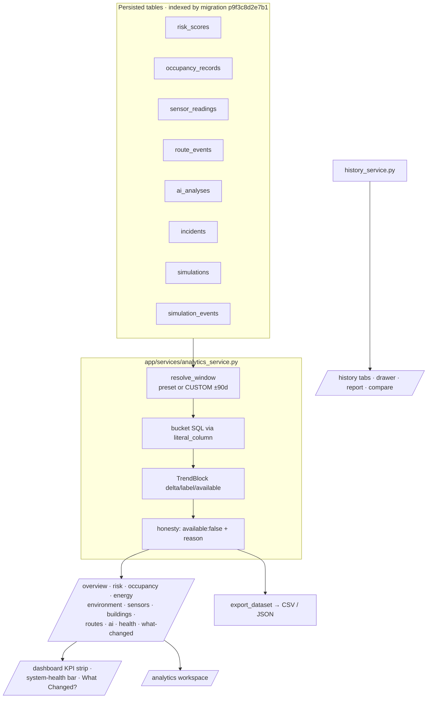

# Analytics (Phase 9)

Server-side aggregation for the Command Center (`/dashboard`), the Analytics
workspace (`/analytics`) and the History page (`/history`). Every number on
those screens is computed by the backend from **persisted rows** — the frontend
never invents, interpolates or fakes a series.

## Principles

1. **Server-side aggregation** — the browser receives already-bucketed series
   and already-computed stats; no client-side reduction of raw rows.
2. **Honesty over completeness** — a block with no rows in the window returns
   `available: false` plus a human-readable `reason`. Series are never
   synthesized to fill gaps; trends with <2 points report
   `direction: FLAT, available: false`.
3. **One source of truth for bands** — risk bands match `state.risk_level()`
   exactly (see below); incident severity keeps its own LOW/MEDIUM/HIGH/CRITICAL
   ladder.
4. **RBAC** — every endpoint requires `read` (401 without a token), so viewers
   can see analytics but not mutate anything.
5. **No new chart library** — responses are Recharts-friendly `{t, value}`
   points.

## Windows

`resolve_window(range, start, end)` → `Window{preset, start, end, bucket_s}`
(naive UTC, matching how rows are stored):

| Preset | Span | Bucket | Typical use |
|---|---|---|---|
| `15M` | 15 min | 60 s | live drill watch |
| `1H` | 1 h | 60 s | current hour |
| `6H` | 6 h | 300 s | shift view |
| `24H` | 24 h | 900 s | default |
| `7D` | 7 d | 7200 s | weekly |
| `30D` | 30 d | 28800 s | monthly |
| `CUSTOM` | `start`…`end` | adaptive (60 s…86400 s, ~150 points) | ad-hoc |

`CUSTOM` is validated: missing `end` → now, missing `start` → end−24 h,
`end ≤ start` → start = end−24 h, span capped at **90 days**
(`MAX_CUSTOM_DAYS`), `end` clamped to now+5 min. Unknown presets fall back to
`24H`. Bucket SQL uses `literal_column` so SQLAlchemy does not compile `/` as
`a / (? + 0.0)` on SQLite.

## Endpoints

All under `/api/analytics`, all `Depends(require("read"))`. Common query
params: `range` (preset or `CUSTOM`), `start`, `end` (ISO-8601).
`building_id` scopes **risk, occupancy, energy, environment** (echoed back as
resolved `entity`).

| Endpoint | Returns |
|---|---|
| `GET /overview` | KPI strip: `kpis[]` (value · unit · secondary · `status` · `trend`), `counts`, `confidence.prediction_accuracy` (+ `available`) |
| `GET /risk` | `current`, `level`, `stats{avg,max,min,samples}`, `trend`, `time_in_category` (5 bands), `critical_events`, `series`, `heatmap{buckets,rows}`, `factors`, `explanation` |
| `GET /occupancy` | `current/capacity`, `stats`, `series` (value + pct), `trend`, `by_building`, `peak_hour` |
| `GET /energy` | `current`, `stats`, `series`, `trend`, `abnormal{count,definition}`, `by_building` |
| `GET /environment` | `metrics[]` in order **temperature, humidity, air_quality, smoke, water** — each with `stats`, `series`, `trend`, `abnormal_readings`; plus `live_temperature` |
| `GET /sensors` | `totals` (health %, out-of-range, diagnostics), `status`, `by_type`, `diagnostics[]`, `ai_status` |
| `GET /sensors/{id}` | one sensor: `status/healthy`, `series` (value + min/max), `stats`, `trend` — 404 unknown |
| `GET /buildings` | per-building rows: risk (+trend), occupancy, energy, temperature, incidents, sensors, sensor health |
| `GET /buildings/compare?ids=a,b` | 2–3 buildings, `rows[]` of normalized metric cells |
| `GET /buildings/{id}` | one building: row + risk/occupancy/environment blocks + incidents + sensors — 404 unknown |
| `GET /routes` | `stats` (`events`, `by_event` **inside** stats, `by_mode`, distances/ETA), `trend`, `series`, `current{active_routes,…}` |
| `GET /ai` | analyses counts by mode/severity/priority/source, recommendations by status/priority, acceptance rate, `trend`, `series` |
| `GET /system` | system-health strip: component statuses + `updated_at` (drives the dashboard bottom bar) |
| `GET /health` | campus health `score` (0–100), `level`, transparent `components[]` + weights |
| `GET /what-changed?ago=60` | NOW vs N-minutes-ago rows (`ago ≤ 10080`), headline format `"{label} {change} {abs(delta)} {unit}"` |
| `GET /export?kind=&format=csv` | CSV attachment (or `format=json` wrapper). `kind` ∈ summary, risk, occupancy, energy, sensor_health, buildings, routes, incidents, simulations — else 400 |
| `GET /timeseries` | **legacy** Phase 5/6 curve-model endpoint, unchanged for back-compat |

History endpoints (`/api/history`, same RBAC) — see
[REPLAY.md](REPLAY.md) for replay and the list/detail/report/compare
endpoints used by `/history`.

## Risk bands (shared with live risk)

`RISK_BANDS` in `analytics_service.py` mirrors `state.risk_level()`:

| Band | Score |
|---|---|
| LOW | ≤ 20 |
| MODERATE | ≤ 40 |
| ELEVATED | ≤ 60 |
| HIGH | ≤ 80 |
| CRITICAL | > 80 |

`RISK_KPI_STATUS` maps bands to KPI statuses: LOW → `GOOD`,
MODERATE/ELEVATED → `WARN`, HIGH/CRITICAL → `CRITICAL`.
`time_in_category` always reports exactly these five categories (0 s when
empty) — never an invented distribution.

## Frontend

### `/dashboard` (Command Center)

- `components/dashboard/KpiStrip.tsx` — six window KPIs from
  `GET /analytics/overview` with sparklines (occupancy, energy, temperature,
  risk index, incidents, people at risk, anomalies).
- `components/dashboard/SystemHealthBar.tsx` — 9 components from
  `GET /analytics/system`, refreshed every 30 s.
- `components/dashboard/HealthChangesPanel.tsx` — campus health score +
  `GET /analytics/what-changed` rows in the right rail (`ai|health` tabs).

### `/analytics` (workspace)

- Filters are **URL state** — `range,start,end,building,zone,metric,kind,
  status,severity,q,scenario,compare` — so any view is shareable and survives
  refresh; `Reset filters` clears the filter set but keeps the window.
- The window bundle (10 endpoints) is fetched together; incidents,
  simulations, building-compare and sensor detail fetch separately.
- Honest `EmptyWindow` states render whenever a block reports
  `available: false`.
- **CSV export** (`utils/download.ts`) sends the authenticated GET and
  downloads the attachment; `exportAnalytics(kind, windowParams)` keeps the
  export on the active window.

### `/history` (historical intelligence)

Server-side pagination + filters (URL-persisted), incident drawer with
timeline/metrics/report/CSV, simulation drawer with metrics/events/linked
incidents, two-run compare, and the Replay hand-off.

## Indexes (migration `p9f3c8d2e7b1`)

Six indexes over the aggregation columns: risk (time+entity), readings
(by time), occupancy (by time), incidents (status/started_at), simulations
(status/created_at), simulation_events (simulation_id+sim_t). Verified by
`test_phase9_indexes_created`.

## Tests

- `backend/tests/test_phase9_analytics.py` (35) — windows incl. CUSTOM,
  overview KPIs, band/time-in-band, risk/occupancy/energy/environment/sensors/
  buildings/compare/routes/ai/system/health/what-changed, CSV export + bad
  kind 400, incident list/detail/report/export, simulation list/detail/events/
  compare/replay/frame, RBAC 401, legacy timeseries, index presence.
- `backend/tests/smoke_api.py` Phase 9 block (+33) — endpoint smoke against a
  running server.
- `frontend/src/pages/Analytics.test.tsx` (11) — URL-persisted ranges and
  filters, loading/error honesty, export.
