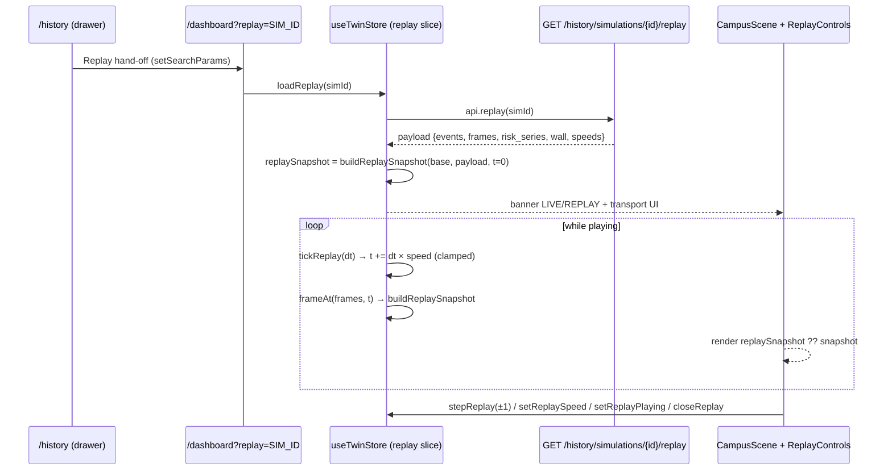

# Simulation Replay (Phase 9)

Deterministic playback of any persisted simulation — timeline, state curves and
the 3D twin — strictly from data the engine already wrote to the database.
Replay is a **read-only projection**: it never mutates live state, never
fabricates values, and the same `(simulation, t)` always yields the same frame.



## Backend

### Endpoints (all `require("read")`)

| Endpoint | Returns |
|---|---|
| `GET /api/history/simulations/{id}/replay?frame_step=` | full payload; `frame_step` optional 0.5–60 s override; 404 unknown sim |
| `GET /api/history/simulations/{id}/frame?t=` | single deterministic frame at sim-time `t` (≥0); same shape as `frames[]` |

Related history endpoints: `GET /api/history/simulations` (filters + server
pagination), `/simulations/{id}` (detail + events-by-category), `/events`,
`/simulations/compare?a=&b=`, `/incidents…`, `/export` — documented in
[ANALYTICS.md](ANALYTICS.md).

### Payload contract (`replay_service.build_replay`)

```
{ simulation, duration_s, frame_step_s, wall, categories, speeds,
  zone_buildings, events, frames, risk_series, route_events,
  ai_analyses, incidents, notes, source, built_at }
```

- **Frames** — sampled from `t = 0` at `frame_step_s` (override, or
  `max(2, min(15, duration/60))` s), capped at `MAX_FRAMES = 500`. Each frame:
  `t, wall, status, last_kind, people_at_risk, fire_fraction, burning_zones,
  risk, occupancy, route, ai, incident`.
- **Determinism** — frames are rebuilt from persisted `simulation_events`
  (ordered by `sim_t`); burning zones are the running set of ignition/recovery
  kinds, so frame `k` is a pure function of the event list. `wall` is derived
  once via `WallClockMap`.
- **`WallClockMap`** — piecewise wall-clock ↔ simulation-time mapping built
  from event pairs, taking events in wall order only while sim-time stays
  non-decreasing (a post-completion reset would otherwise invert time);
  tz-normalized to UTC. Exposed as `wall{start,end,sim_start,sim_end}`.
- **`LIFECYCLE_STATUS`** — event kind → replay status:
  `created/reset → CREATED`, `started/resumed → RUNNING`, `paused → PAUSED`,
  `recovering → RECOVERING`, `stabilized → AWAITING_RECOVERY`,
  `recovered → RECOVERED`, `completed → COMPLETED`. The `ActiveSim` live
  status lacks `RECOVERED`, so replay trusts the payload status.
- **Context** — `events` (full timeline, ordered), `risk_series`,
  `route_events`, `ai_analyses`, `incidents` inside the sim window,
  `zone_buildings` (zone → buildings for the 3D), `categories`, and
  `speeds = [0.5, 1, 2, 5, 10]`.

### Rebuilding a frame (`replay_frame`)

Same derivation as frame `k`, served for any `t` — tests assert
`frame(t_i) == frames[i]` (§61 replay determinism).

## Frontend

### URL hand-off

History drawer → `navigate('/dashboard?replay=' + simId)` (single
`setSearchParams` write — two sequential calls clobber each other in
react-router v6). `/dashboard` reads `useSearchParams().get('replay')` and
runs `loadReplay`; exiting replay clears only the `replay` param.

### Store slice (`useTwinStore`)

- State: `replay: ReplayPayload | null`, `replayT`, `replaySpeed`,
  `replayPlaying`, `replaySnapshot`.
- `frameAt(frames, t)` — clamp to `[0, duration]`, binary-search the frame
  index; exported for unit tests.
- `buildReplaySnapshot(base, payload, t)` — **topology (buildings, zones,
  floors, geometry) from the live base snapshot; every dynamic value
  (status, risk, people at risk, occupancy, burning zones, route/AI/incident)
  strictly from frame `t`**. Missing frame → base unchanged.
- Actions: `loadReplay(id)` / `closeReplay()` (clear + `replaySnapshot: null`),
  `setReplayT` (clamped), `setReplaySpeed` (0.5–10), `setReplayPlaying`,
  `stepReplay(±1)` (one frame-step at a time), `tickReplay(dt)` (advances
  `dt × speed` only while playing, stops at `duration`).

### UI

- `components/replay/ReplayControls.tsx` — PLAY/PAUSE, step, RESET, scrubber,
  speed chips (0.5×/1×/2×/5×/10×), sim-time/wall-time readout, frame stats
  (`data-testid="replay-frame-stats"`), event tick marks, and a LIVE/REPLAY
  indicator driven by `useReplayMode()`.
- `Dashboard` — while replaying, the "Simulations" card slot is replaced by
  the transport; `CampusScene` renders `replaySnapshot ?? snapshot`, so live
  WebSocket updates never leak into a replay (and replay never writes live
  state).
- Event timeline lists persisted events whose `sim_t ≤ replayT`, with
  category filters.

## Guarantees & honesty

- Frames come from stored events only — no synthetic motion, no extrapolation
  beyond the stored `duration_s` (t clamps, playback auto-stops).
- `source`/`notes` in the payload carry provenance text for the UI footer.
- Replay is read-only: no simulation start/pause/reset APIs are called from
  the replay path.

## Tests

- `backend/tests/test_phase9_analytics.py` — replay payload shape, frame
  determinism (`frame == frames[i]`), 404s, RBAC 401.
- `frontend/src/store/replay.test.ts` (17) — `frameAt` clamping/search,
  snapshot derivation (topology from base, dynamics from frame), speed/tick/
  clamp/auto-stop behavior.
- `frontend/src/components/replay/ReplayControls.test.tsx` (14) — transport,
  speeds, scrubber, LIVE/REPLAY banner.
- `frontend/src/pages/History.test.tsx` (13) — replay hand-off writes
  `?replay=` correctly (single URL write).
