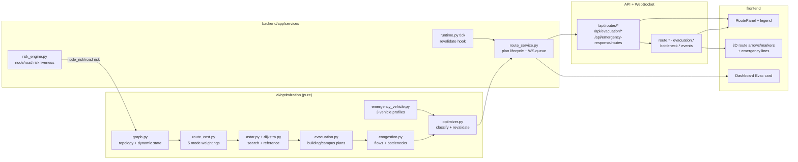

# TwinSphere AI — Routing & Evacuation (Phase 7)

Deterministic route optimization over the Phase 2 campus road graph: five
weight-per-mode A*/Dijkstra routes, campus + per-building evacuation plans,
emergency vehicle response, dynamic invalidation/re-routing, exit-capacity
bottlenecks and a persisted route audit. Structured data only — **no LLM
output anywhere in this path**.



## 1. Graph model (`ai/optimization/graph.py`)

- Nodes = `state.nodes` (35: junctions, 9 building `EXIT` nodes, 3 `GATE`
  nodes), edges = `state.roads` (40). Topology is cached process-wide and
  rebuilt only when the node/road identity set changes.
- `refresh_dynamic()` runs on every read: edge congestion/occupancy/blocked
  come from `state.roads`, edge risk = `max(road.risk, endpoint node risk)`.
- **Risk liveness**: `risk_engine.compute_risk()` writes building risk onto
  the building's exit nodes (`kind == "EXIT"` or `is_exit`), decays it ×0.85
  per AI cycle and propagates to touching roads (`max(road×0.8, endpoint)`).
  Building exit nodes carry `kind="EXIT"` without an `is_exit` flag in the
  seed, so both signals count. A hard simulation reset clears node/road risk
  and snaps the target building's heat/smoke — hazard-derived risk dies with
  the hazard.
- Blocked edges are `math.inf` in the cost function and excluded from
  adjacency expansion; `blocked_edges()` feeds failure payloads.

## 2. Cost model (`route_cost.py`)

```
cost(e) = w_d · distance/REF_DIST + w_t · time/REF_TIME + w_r · risk/100
        + w_c · congestion + w_cap · max(0, load/capacity − 1)
```

| Mode | distance | time | risk | congestion | capacity | traveler |
|---|---|---|---|---|---|---|
| `shortest` | 1.0 | 0 | 0 | 0 | 0 | pedestrian |
| `fastest` | 0.1 | 1.0 | 0 | 0.3 | 0.1 | pedestrian |
| `safest` | 0.2 | 0.1 | **1.0** | 0.2 | 0.1 | pedestrian |
| `balanced` (default) | 0.4 | 0.5 | 0.8 | 0.4 | 0.2 | pedestrian |
| `emergency` | 0.2 | 1.0 | 0.6 | **0.7** | 0.3 | emergency vehicle |

Calibration constants (single source of truth in `graph.py`):

| Constant | Value | Meaning |
|---|---|---|
| `REF_DIST` | 100 m | distance normaliser |
| `REF_TIME` | 60 s | time normaliser |
| `EDGE_CAPACITY_BASE` | 200 people/min | throughput at stored capacity 1.0 |
| `EXIT_FLOW_PER_CAPACITY` | 312.5 people/min | `gate_main` (1.6) → 500 ppm |
| `WALK_SPEED` | 1.35 m/s | pedestrian edge time, `×(1+1.5·cong)` |
| `VEHICLE_SPEED` | 8.3 m/s | vehicle edge time, `×(1+1.0·cong)` |

Edge travel times are recomputed from congestion on every dynamic refresh.

## 3. Search, alternatives, classification

- `astar()` — primary search, admissible heuristic = euclidean distance ×
  the mode's distance weight (weight 0 degrades to Dijkstra automatically).
- `reference_dijkstra()` — ground truth for tests/audit (`test_astar_matches_dijkstra_reference`).
- `calculate_route(alternatives=N)` enumerates distinct paths
  (`multi_route_search`) and classifies them:
  `RECOMMENDED` (lowest risk/time among viable) → `ALTERNATIVE` →
  `NOT_RECOMMENDED` (high-risk) → `BLOCKED` (no path). The activated plan is
  the classified `RECOMMENDED` row when one exists.
- Comparison rows (`/api/routes/alternatives`) run each mode's A* separately;
  row `status` is that mode's own verdict and `recommended: true` marks the
  pick (ties → balanced > safest > fastest > shortest). When every mode is
  high-risk (e.g. origin inside a burning building) `recommended_mode` is
  `null` — honestly "no safe mode right now".

Safety thresholds (`evacuation._safety`, on path aggregates):

| Result | Condition |
|---|---|
| `HIGH_RISK` | avg risk ≥ 55 **or** max edge risk ≥ 75 |
| `WARNING` | avg risk ≥ 30 **or** congestion ≥ 0.6 |
| `SAFE` | otherwise |

`risk_score` = mean edge risk over the path; `max_risk` = worst edge.

## 4. Evacuation (`evacuation.py`)

- **Per-building plan** (§15): routes from each building exit to the campus
  goal set, ranked; exit roles `PRIMARY` / `SECONDARY` / `UNAVAILABLE`,
  queue time = `people / exit_flow_capacity × 60 s`, exit pressure =
  `demand / capacity` over a 1-minute horizon.
- Building plan status ladder: `EVACUATION_CRITICAL` (all exits blocked) →
  `ACTIVE` (a path exists and people are at risk or route risk ≥ 30) →
  `READY`. A path that exists but only crosses high-risk segments stays
  ACTIVE — a burning building must never de-escalate because its escape
  route is dangerous (it reports `NOT_RECOMMENDED` on the route itself).
- **Campus plan** (§8/§12): every building planned, demand aggregated per
  destination exit, bottlenecks detected, status ladder:
  `CRITICAL` (any building critical, or all blocked) → `ACTIVE` (any building
  active) → `STANDBY` (affected buildings but no active plan) → `IDLE`.
- **Exit capacity model**: greedy demand assignment across candidate exits
  respecting per-exit discharge capacity.

## 5. Congestion & bottlenecks (`congestion.py`)

Three structured detectors (no free text beyond fixed recommendation strings):

| Kind | Trigger | Severity |
|---|---|---|
| `EXIT` | exit pressure > 1.0 | HIGH > 1.5 else MEDIUM |
| `EDGE` | demand > edge capacity (or congestion ≥ 0.85 / high risk) | HIGH/ MEDIUM per rule |
| `NODE` | corridor junction carrying ≥ 400 shared load | MEDIUM |

Recommendation vocabulary: `Distribute evacuation toward an alternative gate`,
`Reroute around the congested segment`, `Hold occupants until congestion clears`.
Bottleneck rows carry `location`, `estimated_people`, `capacity`, `congestion`,
`risk`, `shared_by`. Baseline campus demand exceeds the 200 ppm edge
calibration on busy segments, so a clean campus can already report structural
bottlenecks — they are demand-vs-capacity facts, not incidents.

## 6. Emergency vehicles (`emergency_vehicle.py`)

Profiles `fire_truck` / `ambulance` / `security` (mode `emergency`):
vehicle speed, emergency-only edge permissions, access restrictions and gate
targets. `/api/emergency-response/routes` returns all three (or one via
`?vehicle=`) with per-vehicle status `SAFE/WARNING/BLOCKED`,
distance, ETA, risk and `blocked_roads_avoided`. With no incident and no
`?destination=` it returns `NO_SAFE_ROUTE` + empty routes rather than
inventing a target.

## 7. Invalidation & re-routing (`optimizer.py` + `route_service.py`)

`check_route_validity` reasons (blocking set **bold**):

- **`edge_blocked` / `edge_missing`** — road closed or removed under the plan.
- **`risk_increased`** — any plan edge gained ≥ 25 risk since planning.
- **`destination_unavailable`** — plan end is not an exit/gate/assembly node.
- **`exit_unavailable`** — destination exit node risk ≥ 75 (serving building critical).
- `congestion_increased` — edge congestion ≥ 0.75 (advisory, non-blocking).
- `risk_decreased` — advisory improvement signal.

`route_service.revalidate(state)` runs every runtime tick and on relevant API
calls: validates the active plan, emits `route.invalidated` + auto-recalculates
(`route.recalculated`), and — when campus evacuation is `ACTIVE`/`CRITICAL`
and no plan is active — activates a building evacuation plan
(`route.calculated` + `evacuation_status`). Environment-improvement adoption
is gated by `IMPROVE_RISK_DELTA = 10` / `IMPROVE_TIME_RATIO = 0.85` (§32):
never churn the plan for noise.

## 8. API surface (`app/api/routes_evacuation.py`)

| Endpoint | Purpose |
|---|---|
| `GET /api/routes/graph` | nodes/edges + dynamic risk state |
| `POST /api/routes/calculate` | point-to-point plan (role `apply`, 400 on bad mode/node/sim id) |
| `POST /api/routes/recalculate` | force revalidation of the active plan (404 without one) |
| `GET /api/routes/alternatives` | recommended + alternatives + cross-mode comparison |
| `GET /api/routes/evacuation` | campus overview (buildings/exits/bottlenecks), refreshed |
| `GET /api/evacuation/status` | overview + active plan + live route history |
| `GET /api/evacuation/building/{id}` | per-building plan (activates it) |
| `GET /api/routes/emergency` | emergency route(s) to the incident |
| `GET /api/emergency-response/routes` | all/one vehicle routes (`?vehicle=&origin=&destination=`) |
| `GET /api/routes/bottlenecks` | current bottleneck list |
| `GET /api/routes/history?limit=` | persisted `route_events` audit (survives resets) |
| `GET /api/routes/{route_id}` | active plan first, then persisted row + its events |

All Phase 7 paths are distinct literals registered after the legacy
`GET /api/routes` router, so legacy behaviour is untouched. `simulation_id`
in any body is validated against the active simulation (400 on mismatch).

## 9. WebSocket events (envelope v1)

```
route.calculated | route.updated | route.invalidated | route.recalculated
emergency_route.updated
evacuation.started | evacuation.updated | evacuation.completed
bottleneck.detected | bottleneck.cleared
```

Queued through the runtime flush (`queue_route_event`), content-gated so
steady-state ticks do not spam (evacuation refresh only emits on status or
content change).

## 10. Frontend

- **RoutePanel** (`/twin`, routes tab or overlay): evacuation strip,
  calculator (origin/destination grouped exits vs gates, 4 mode chips),
  active plan metrics + recalculation, cross-mode table, per-building plans,
  bottlenecks, emergency dispatch, persisted history, colour legend.
- **3D**: animated chevron arrows along the active plan, origin/destination
  markers, dashed per-vehicle emergency lines, bottleneck pulse rings
  (EvacuationRoutes + RouteArrows/RouteMarkers/EmergencyRoutes).
- **Dashboard**: `Evac Plan` metric tile (status tone, people at risk, plan
  mode/version) opens the twin with the route panel.
- **Demo Mode**: step 9 `show_route_panel` opens the panel over the twin;
  demo reset clears the client route slice and re-syncs.
- Mode colours: shortest `#38bdf8`, fastest `#f97316`, safest `#22c55e`,
  emergency `#f43f5e`, balanced `#a78bfa`; safety SAFE/WARNING/HIGH_RISK.

## 11. Persistence

- `route_events` (migration `p7c4e8b2d9f1a`) — append-only audit of every
  calculate/evacuation/emergency activation; **survives** demo reset and is
  what `/api/routes/history` serves.
- `evacuation_routes` — persisted primary plans for `GET /api/routes/{id}`.
- In-memory `state.route_history` (cap 40) powers `route_history_recent` and
  is cleared by demo reset — the smoke suite asserts both semantics.

## 12. Tests

```powershell
cd backend
.venv\Scripts\python -m pytest tests -q          # 130 passed (incl. 24 Phase 7)
.venv\Scripts\python tests\smoke_api.py          # all pass (~128; 3 conditional on live state)
.venv\Scripts\python tests\ws_check.py           # 43/43 (+ route.* events)

cd frontend
npm run test                                     # 90 passed (+ routeEvents + routePanel)
```

Walkthrough evidence (scripted, live server): graph 35/40 → clean-state
overview `IDLE` → `calculate safest` returns a longer, lower-risk path than
`shortest` (186 m / risk 1.7 vs 132 m / risk 2.4) → alternatives table →
version bump on recalculate → exit-role building plan → 3 vehicle routes →
fire drill: evacuation flips `ACTIVE`, plan auto-activates, exit risk 100
makes every escape route `HIGH_RISK`/`NOT_RECOMMENDED` honestly → reset
restores `IDLE` and clears live history while the persisted audit survives.

## Related

- Architecture: `docs/architecture.md`
- API reference: `docs/api.md`
- Simulation engine: `docs/simulation.md`
