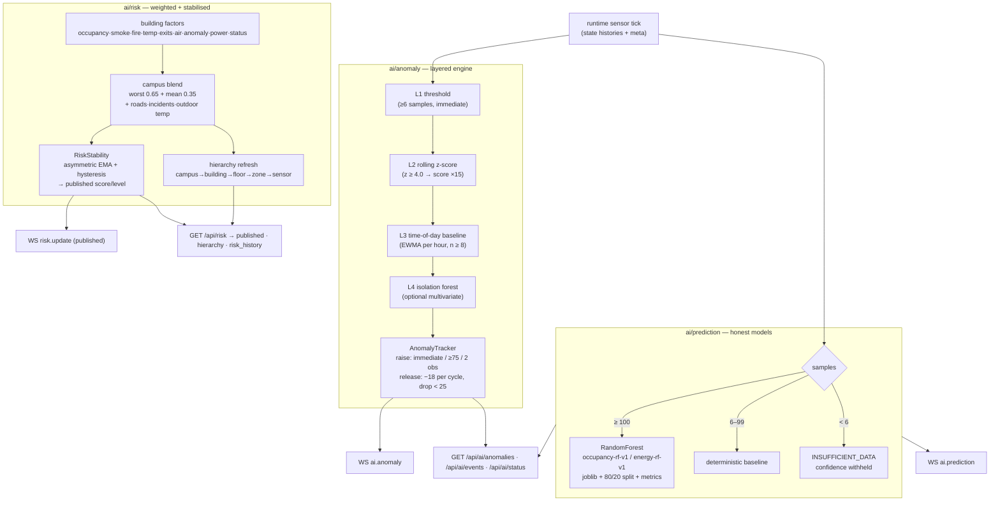
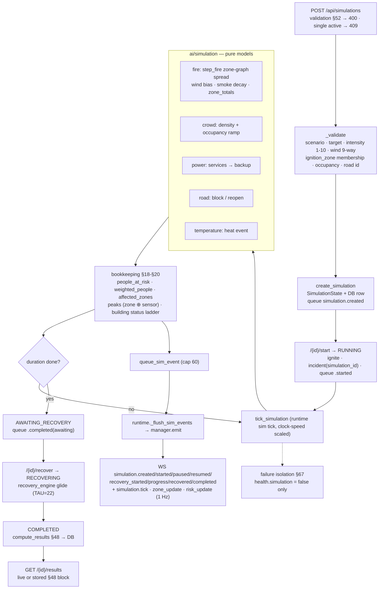
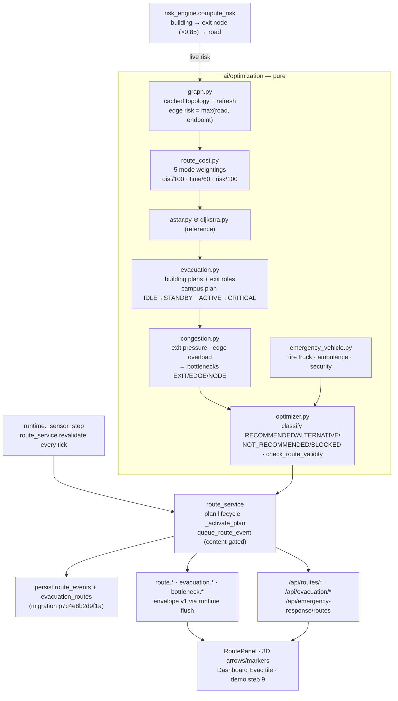

# TwinSphere AI — Architecture

End-to-end view of the platform as built through **Phase 6** (Phases 1–6 complete).
Honesty rule that governs every layer: *all telemetry is produced by a deterministic
simulator and labelled `SIMULATED`; real IoT can replace the simulator without touching
the AI, optimisation or visualisation layers.*

```mermaid
flowchart LR
    subgraph Backend["backend/ — FastAPI"]
        API[REST API app/api/*]
        RT[Runtime loop<br/>sim-gated sensor tick · sim tick · AI refresh<br/>+ simulation.* event flush]
        WS[WebSocket /ws<br/>state · simulation · event · analyst<br/>+ typed live events + AI events<br/>+ simulation.* events]
        DB[(SQLite / PostgreSQL)]
        API --> DB
        RT --> DB
        RT --> WS
        API -->|realtime controls| RT
    end
    subgraph AI["ai/ — engines"]
        RISK[Risk] · PRED[Prediction] · ANOM[Anomaly]
        OPT[Optimisation] · SIM[What-if simulation] · LLM[Analyst + LLM]
    end
    RT --> RISK & PRED & ANOM & OPT & SIM & LLM
    subgraph FE["frontend/ — React 18 + Vite"]
        SVC[services/api · services/ws]
        ST[Zustand useTwinStore]
        PAGES["pages: Dashboard · Twin · History · Simulation · AI · Settings"]
        TWIN["twin/ + 3d/: R3F scene, inspectors, live panels, hazard visuals"]
        SVC --> ST --> PAGES --> TWIN
    end
    API -->|REST| SVC
    WS -->|push| SVC
```

## Backend (`backend/`)

- **App** — `app/main.py` boots FastAPI, CORS, auth middleware, WebSocket endpoint,
  the background runtime loop and an additive schema sync (`ensure_schema()`); Alembic
  (`backend/alembic/`, baseline `b3937b6fe73a`) is the production migration path.
- **Runtime loop** — gated by the simulation status (`RUNNING`/`PAUSED`/`STOPPED`):
  while `RUNNING` the sensor tick (`SENSOR_TICK_SECONDS`, default 2 s) reads diurnal
  curves + drift from the sensor engine (through a pure `SimulationContext` carrying
  active-scenario modifiers), advances the virtual clock, ticks any active simulation
  and refreshes AI results; while paused the clock freezes and a heartbeat keeps
  clients informed. Telemetry is persisted in batches (`SIMULATION_PERSIST_INTERVAL`,
  default 20 s) instead of every tick, and each tick pushes typed live events plus the
  legacy `state` frame.
- **Realtime controls** — `app/api/routes_realtime.py` exposes
  `/api/realtime/{status,start,pause,resume,reset,speed}`; mutations require the
  `simulate` permission (ADMIN/OPERATOR), are audited, validate speed against
  `{1,2,5,10}` and broadcast `simulation.status` + `system.status` on every change.
- **Data model (18 tables)** — `users`, `buildings`, `floors`, `zones`, `road_nodes`,
  `roads`, `sensors`, `sensor_readings`, `evacuation_routes` + `evacuation_route_nodes`,
  `incidents`, `simulations` + `simulation_events`, `risk_scores`, `predictions`,
  `recommendations`, `system_alerts`, `audit_logs`.
- **API groups** (`app/api/routes_*.py`) — auth (JWT), campus/buildings/floors/zones/sensors
  (with history), risk, routes (A*), AI (predictions/anomalies/analyst/analyze), incidents,
  recommendations, simulations (create/start/pause/resume/reset/recover + events),
  realtime controls, analytics, settings/system/demo. Raw resource objects (no envelope);
  ids resolve by internal id **or** human `code`/`sensor_code`; every telemetry payload
  carries `source: SIMULATED`.
- **WebSocket** — `/ws` pushes the four backbone message types (`state`, `simulation`,
  `event`, `analyst`) plus five versioned live events per tick:
  `sensor.batch_update`, `occupancy.update`, `building.update`, `simulation.status`,
  `system.status`. Typed events use the envelope
  `{type, event, event_version: 1, timestamp, source: "SIMULATED", data, payload}`
  (payload aliases data for backwards compatibility). Phase 6 adds the `simulation.*`
  family (lifecycle + `simulation.tick`/`zone_update`/`risk_update`), queued by the sync
  engine and flushed by the runtime. `WEBSOCKET_ENABLED=false` refuses
  the upgrade with close code 1013.

### Key REST responses

| Endpoint | Notes |
|---|---|
| `GET /api/campus` | snapshot **+** `summary` (counts, occupancy, risk), `data_source`, `metadata`, `route_report` |
| `GET /api/buildings/{id}` | building detail: zones, sensors, `risk_detail`, exits, routes, incidents, predictions |
| `GET /api/buildings/{id}/floors` | floor rows (`{CODE}-F{n}`, `floor_number`, `zone_count`) |
| `GET /api/zones`, `/api/sensors` | lists used by the twin's REST fallback; zone placement from `local_x`/`local_z` |
| `GET /api/sensors/{id}/history?limit=288` | persisted readings (chronological ascending, 5-min spacing = 24 h), `data_source` |
| `GET /api/realtime/status` | simulator status: `status` (RUNNING/PAUSED/STOPPED), `speed`, `clock`/`clock_hour`, `last_tick`, `tick_count`, `connected_clients`, `data_source`, `seed`, `scenario`, `enabled` |
| `POST /api/realtime/{start,pause,resume,reset,speed}` | backend-authoritative controls (`simulate` role, audited, idempotent pause/resume, speed ∈ {1,2,5,10} → else 400) |

## AI engines (`ai/`)

Deterministic-first: risk scoring, time-series prediction, anomaly detection,
evacuation/route optimisation, what-if simulation, and the natural-language analyst
(optional `LLM_API_KEY`, otherwise `local_fallback` — surfaced as `aiFallback` in the UI).
Inputs/outputs are plain dicts/Pydantic schemas shared with `backend/app/schemas`.

### Phase 5 — AI cycle (anomaly → prediction → risk)

Runs from the runtime loop only while the simulation is `RUNNING`, every
`AI_ANALYSIS_INTERVAL_SECONDS` (15 s). Failures mark the engine degraded — the
simulator, WS and REST keep working regardless.



Legacy wrappers (`detect_anomalies`, `predict_series`) keep Phase 1 call-sites working
unchanged. Anomaly ≠ risk ≠ incident: an anomaly is a deviation from expected telemetry,
risk is the weighted campus index, incidents are declared events.

### Phase 6 — Emergency what-if engine

One orchestrator (`app/services/simulation_engine.py`) over pure scenario modules in
`ai/simulation/`; `SimulationState`/`SimulationContext` (state.py) feed the sensor
engine, risk engine and the 3D twin through the existing runtime — no second clock,
no duplicate loop.



Sensor feedback: the sensor engine applies fire heat coupling (zone heat → building
temperature) alongside the existing smoke/AQ coupling, so instruments move with the
scenario. Recovery walks building status back to `OPERATIONAL` gradually — state is
never teleported.

### Phase 7 — Route & evacuation optimization

Pure route engines in `ai/optimization/` behind a single service
(`app/services/route_service.py`); the runtime tick owns revalidation, the risk
engine owns node/road risk liveness, and everything else reads.



Invalidation rules live in `optimizer.check_route_validity` (`edge_blocked`,
`risk_increased` Δ≥25, `exit_unavailable` ≥75, `destination_unavailable`;
congestion/risk-drop are advisory) — a blocking reason queues
`route.invalidated` and triggers an immediate re-plan with improvement gating
(`IMPROVE_RISK_DELTA`/`IMPROVE_TIME_RATIO`). A hard simulation reset clears
hazard-derived node/road risk with the hazard. Full calibration constants and
endpoint inventory: `docs/ROUTING.md`.

### Phase 8 - AI analyst & decision support

Pure, provider-agnostic analyst (`ai/analyst/`) over the Phase 1–7 engines.
`build_context()` normalizes the live state (mode auto-detect, signature) →
`run_analysis()` computes evidence, a 6-component confidence score, ranked
recommendations and change detection **deterministically**; an optional LLM
(`LLM_*` env) only rephrases the narrative and passes `semantic_validate`
(entity/number grounding) before it is shown — any failure falls back to
`fallback.py` so the platform works with no key and never blocks the sim loop.

`backend/app/services/analyst_service.py` owns orchestration around it:
signature cache (20 entries, `POST /api/ai/analyze` forces), cooldown
(`ANALYST_COOLDOWN_SECONDS`, 5 s at CRITICAL), fire-and-forget runtime
triggers on risk change/cadence, health bookkeeping
(`ONLINE|FALLBACK|DEGRADED|OFFLINE`) and persistence to `ai_analyses` /
`ai_recommendations` / `ai_evidence` (migration `p8d9f4b7a2c6e`, bounded to
100 analyses). Results arrive as strict `AnalystResult` (Pydantic) via
`POST /api/ai/analyze` + `GET /api/ai/analysis*` / `recommendations*` /
`evidence/*`, typed `analyst.*` WS events (envelope v1), human-in-the-loop
recommendation decisions (role `apply`), and the `/ai` brief + evidence panel +
decision workflow + status pill.

## Frontend (`frontend/`)

- **Shell** — React Router pages: Dashboard, `/twin`, History, Simulation Center, AI
  Intelligence, Settings, Login. Tailwind v4 theme (`index.css`) with `ink/line/mist/brand`
  tokens; shared `.panel/.chip/.btn/.label-cap/.num` utilities.
- **State** — a single Zustand store (`store/useTwinStore.ts`): auth, connection status
  (`CONNECTED/DEGRADED/OFFLINE` + `backendOffline`), snapshot, selection
  (building → floor → sensor), layer toggles/view mode/sensor filter, camera requests,
  toasts, demo state, and the Phase 4 realtime state: `realtime` (status/speed/clock),
  `systemStatus` (last `system.status` event), plus **bounded** live buffers —
  `metricHistory` (30 samples → honest trend arrows), `sensorLiveWindow` (120 points,
  cleared on sensor select), `liveLog` (40 observed control/status/risk/system entries).
  `onSocketMessage` **merges** `state` frames over the last snapshot so campus-only keys
  from `GET /api/campus` (`summary`, `data_source`, `metadata`, `route_report`) survive
  live pushes, and dispatches the five typed Phase 4 events.
- **Data services** — `services/api.ts` (typed REST, JWT, `ApiError`, 401 → logout event,
  `realtimeStatus/realtimeAction/realtimeSpeed`) and `services/ws.ts` (`TwinSocket` with
  reconnect, silence detection → DEGRADED, and a 4 s client ping heartbeat).
- **Hooks** — `useCampus` (WS primary; REST fallback `/api/zones`+`/api/sensors` every 15 s
  when degraded/missing; campus summary refresh 60 s), `useTwinSelection`
  (selection rules + focus), `useTwinCamera` (reset/top/overview/focus commands routed
  through the store).
- **3D layer** (`components/3d/`) — R3F `CampusScene` with a damped `CameraRig`,
  `BuildingBlock` (per-type architecture, x-ray when zones/floor are shown), `Zone`,
  `Floor` highlight band, `SensorMarkers` (instanced, type-filtered, tooltips; instance
  matrices/colors are keyed so a 2 s telemetry update rewrites nothing that didn't
  change, and hover tooltips derive live values by id), `IncidentMarker` (ACTIVE
  incidents only), `Roads`, `Labels`, `Ground`, `Nature`, `Parking`, crowd/route/heatmap
  overlays. Shadows are deliberately off (perf); the pulse loop reuses scratch objects
  (zero allocation per frame).
- **Twin UI** (`components/twin/`) — `TwinToolbar` (view modes + camera presets),
  `LayerControls` (13 layers + scene extras + sensor-type filter), `CampusLegend`,
  `TwinStatusBar` (connection truth + pulsing **LIVE** badge while streaming, data
  source, sim status/clock/speed, counts, last update), `CampusOverview` (live trend
  panel with honest "—" until ≥5 samples), `BuildingInspector` (live occupancy/status/
  risk + streamed zone readings + Phase 5 **Risk — Published** block), `SensorInspector`
  (live streaming chart above the 24 h history + Phase 5 **AI Status** block),
  `SimControlPanel` (start/pause/resume/reset + 1x/2x/5x/10x, read-only for
  VIEWER/ANALYST, disabled when `SIMULATION_ENABLED=false`), `SystemStatus` +
  `LiveEvents` (rail "live" tab).
- **Phase 5 AI slice** — bounded store state (`anomalies` 50, `aiPredictions` 60,
  `aiEvents` 40, `sensorAiStatus`, `aiStatus`, `riskPublished` + `riskPublishedBuildings`,
  `aiDegraded`) fed by `refreshAi()` (5 parallel GETs, silent failure → degraded, no
  toast spam) and by the WS handlers `ai.anomaly` / `ai.prediction` / `risk.update`.
  `/ai` polls every 20 s and always renders the AI-limitations disclaimer.
  **RISK MODE** (`viewMode: 'risk'` / `toggles.risk`) tints `BuildingBlock` toward the
  published band colour, and `SensorMarkers` pulses flagged sensors with a `!` badge
  (colour + motion + icon — never colour alone).

### Twin data flow

```
simulation context (scenario modifiers) → sensor engine tick
   ├─ typed WS events: sensor.batch_update → occupancy.update → building.update
   │                   → simulation.status → system.status  (envelope v1, source=SIMULATED)
   ├─ legacy WS state frame (backbone, every tick) → services/ws → store.mergeSnapshot
   ├─ batched persistence: sensor_readings every SIMULATION_PERSIST_INTERVAL (20 s)
   ├─ (link down / missing zones-sensors) → useCampus REST fallback → store
   ├─ campus summary refresh (60 s) → GET /api/campus → store
   └─ store → CampusScene (scene graph) + inspectors/live panels (React)
controls: SimControlPanel → POST /api/realtime/{start,pause,resume,reset,speed}
        → runtime.on_control_change → simulation.status broadcast → store.realtime
selection: rail/scene click → selectBuilding → GET /api/buildings/{id}
           floor chip → selectFloor (scopes zones/sensors + scene highlight)
           sensor chip/marker → selectSensor → GET /api/sensors/{id}/history → chart
                             (+ sensorLiveWindow fed by live events, max 120 pts)
```

## Testing

| Suite | Command | Covers |
|---|---|---|
| Backend pytest | `python -m pytest tests -q` (156) | unit + integration incl. Phase 2 campus data, Phase 4 realtime/context, Phase 5 anomaly/prediction/risk/AI cycle, Phase 6 what-if simulation, Phase 7 routes/evacuation/bottlenecks, Phase 8 analyst pipeline/persistence/RBAC/WS |
| Backend smoke | `python tests/smoke_api.py` (147/147) | live end-to-end API checks incl. realtime controls, Phase 5 AI/risk endpoints, Phase 6 simulation drill/results/validation, Phase 7 route/evacuation/emergency/history endpoints, Phase 8 analyst run/decisions/evidence/status |
| WebSocket | `python tests/ws_check.py` (48/48) | connect/auth/state frames, ping/pong, all typed events + envelopes incl. `ai.*`, Phase 6 `simulation.*`, Phase 7 `route.*`/`evacuation.*`/`bottleneck.*` and Phase 8 `analyst.*` |
| Frontend | `npm run test` (97, Vitest + Testing Library) | geo utils, store rules/WS merge, realtime store + panels, twin page, AI Intelligence page, Phase 6 simulation store slice, Phase 7 route events + RoutePanel, Phase 8 AnalystBrief/EvidencePanel |
| Static | `npm run typecheck && npm run build`, `tsc -b` | strict TS across frontend |

## Phase status

- **Phase 1** — core platform: auth, twin state, runtime loop, WS, engines, 3D scene, ops UI.
- **Phase 2** — campus data layer: buildings/floors/zones/sensors + history APIs, seed data, Alembic baseline.
- **Phase 3** — interactive 3D digital twin: `/twin` rebuilt on real Phase 2 data with layered
  controls, honest connection/data-source UX, floor-aware selection and sensor history charts.
- **Phase 4** — realtime simulation & live digital twin: simulation-gated runtime with
  `SimulationContext`, versioned typed WS events, backend-authoritative `/api/realtime`
  controls (RBAC + audit), batched persistence, and live UI (SimControlPanel, LIVE badge,
  live trends/inspector streams, SystemStatus, bounded LiveEvents).
- **Phase 5** — AI anomaly detection, prediction & risk intelligence: layered anomaly
  engine (threshold / rolling z / time-of-day / isolation forest) with persistence and
  honest cold start, prediction models with metrics/versioning/persistence and
  confidence-withheld fallbacks, weighted risk engine with hierarchy + stabilised
  (EMA/hysteresis) published view, AI scheduler with `ai.anomaly`/`ai.prediction`/
  `risk.update` WS events, `/api/ai/*` + enriched `/api/risk`, AI Intelligence page,
  Dashboard AI strip, inspector AI/risk blocks, RISK MODE in the 3D twin.
- **Phase 6** — emergency what-if simulation engine: pure scenario modules
  (`ai/simulation/`) for fire/crowd/power/road/temperature with wind + intensity,
  zone-graph fire spread with weighted people-at-risk, sensor heat/smoke coupling,
  building status ladder (NORMAL → ALERT → DANGER → CRITICAL), gradual recovery +
  persisted §48 results, single-active 409/validation 400, `GET /api/simulations/{id}`
  and `/{id}/results`, typed `simulation.*` WS events (tick/zone_update/risk_update +
  lifecycle), failure isolation, Simulation Center console upgrade, global
  SIMULATION ACTIVE banner, 3D hazard visuals + FOCUS INCIDENT.
- **Phase 7** — route & evacuation optimization: pure route engines
  (`ai/optimization/`: graph, cost/mode weights, A*/Dijkstra, congestion,
  evacuation plans, emergency vehicles, validity/classification), five route
  modes with live risk liveness (building → exit node → road), campus +
  per-building evacuation plans with exit roles and status ladders,
  exit-capacity bottlenecks, tick-time invalidation + auto re-routing with
  improvement gating, `route.*`/`evacuation.*`/`bottleneck.*` WS events,
  `/api/routes/*` + `/api/evacuation/*` + `/api/emergency-response/routes`
  (legacy `GET /api/routes` untouched), `route_events` audit (migration
  `p7c4e8b2d9f1a`), Routes & Evacuation panel + 3D arrows/markers/emergency
  lines + Dashboard Evac tile + demo step 9.
- **Phase 8** — AI analyst & decision support: evidence-grounded,
  provider-agnostic analyst (`ai/analyst/` with mandatory deterministic
  fallback, signature cache + cooldown, semantic validation of LLM prose),
  strict `AnalystResult` schema with confidence/freshness and severity/priority
  ladders, human-in-the-loop recommendation decisions (role `apply`),
  `/api/ai/analyze|analysis|recommendations|evidence` + status health,
  typed `analyst.*` WS events, `ai_analyses`/`ai_recommendations`/`ai_evidence`
  (migration `p8d9f4b7a2c6e`), AI-page brief + evidence panel + decision
  workflow + status pill, Dashboard AI-INSIGHT block, `docs/AI_ANALYST.md`.
